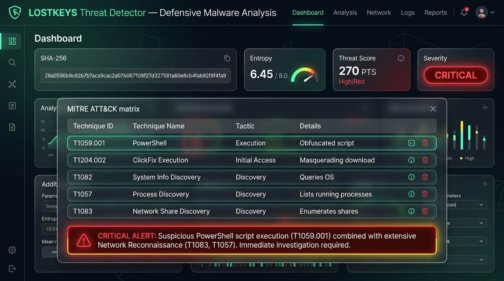

# 🛡️ LOSTKEYS Threat Detector
### *Defensive Malware Analysis & IOC Detection Engine*
**B.Sc. Cybersecurity Final Project | Academic Case Study: 2025 COLDRIVER / Star Blizzard ClickFix Attack Chain**

---

[](https://github.com/USER/LOSTKEYS-Threat-Detector/actions)
[](https://www.python.org/downloads/)
[](https://streamlit.io/)
[](https://opensource.org/licenses/MIT)

---

## 📌 Executive Summary & Abstract

**LOSTKEYS Threat Detector** is a specialized, 100% static, defensive threat analysis and indicator-of-compromise (IOC) correlation platform built to analyze attack vectors, ClickFix lure scripts, and Stage-1 payloads associated with the **2025 GTIG COLDRIVER / Star Blizzard (LOSTKEYS)** cyber espionage campaign.

Adversaries in this campaign employ social engineering techniques (dubbed **ClickFix**) to trick victims into copying and executing obfuscated PowerShell stagers under the guise of resolving browser or system errors. **LOSTKEYS Threat Detector** provides rapid triage, automated Base64 de-obfuscation, Shannon entropy computation, rule-based risk scoring, and interactive MITRE ATT&CK technique mapping through a modern web dashboard.

---

## 🏗️ Architecture & Analysis Pipeline Workflow

The engine processes input telemetry through a multi-stage static analysis pipeline:

```mermaid
flowchart TD
    A[Telemetry / Log Input] --> B[Module: Hasher & Normalizer]
    B -->|SHA-256 & Shannon Entropy| C[Module: Threat Engine]
    B -->|Defanged / Refanged Normalization| C
    
    C --> D1[Rule 1: Known Hash Check (+60 PTS)]
    C --> D2[Rule 2: C2 Domain / IP IOC Match (+50 PTS)]
    C --> D3[Rule 3: Script Syntax & Lure Flags (+20 PTS)]
    C --> D4[Rule 4: Host/Network Recon Commands (+15 PTS)]
    C --> D5[Rule 5: Multi-Signal Correlation Bonus (+20 PTS)]
    
    D1 & D2 & D3 & D4 & D5 --> E[Scoring & Risk Classifier]
    E --> F[MITRE ATT&CK Mapping Engine]
    F --> G[Base64 Payload De-obfuscator]
    
    G --> H[Streamlit Interactive Dashboard]
    G --> I[Module: Reporter HTML & JSON Export]
```

---

## 📊 Threat Scoring Model & Risk Classification

The threat engine scores samples based on deterministic security rules:

| Rule Category | Weighted Points | Signal Condition | Mapped MITRE ATT&CK |
| :--- | :---: | :--- | :--- |
| **Known SHA-256 Hash Match** | **+60 PTS** | SHA-256 matches documented GTIG LOSTKEYS payload | **T1204.002** (User Execution) |
| **C2 Domain / IP Match** | **+50 PTS** | Matches `cloudmediaportal[.]com` or `165.227.148[.]68` | **T1071.001** (Web Protocols) |
| **Suspicious Script Syntax** | **+20 PTS** | `-w hidden`, `-enc`, `DownloadString`, `iex`, `FromBase64String` | **T1059.001** (PowerShell) |
| **Host/Network Reconnaissance** | **+15 PTS** | `ipconfig /all`, `net view`, `tasklist`, `whoami` | **T1057**, **T1082**, **T1083** |
| **LOSTKEYS Keyword Match** | **+15 PTS** | String match for `LOSTKEYS` malware identifier | **T1204.002** |
| **Multi-Signal Correlation Bonus** | **+20 PTS** | Simultaneous script execution flags + Network IoC / Recon | **Attack Chain Correlation** |

### Severity Scale
- 🟢 **LOW (0 – 29 PTS):** Benign log or clean system administration script.
- 🟡 **MEDIUM (30 – 59 PTS):** Suspicious script execution flags or minor recon commands.
- 🟠 **HIGH (60 – 79 PTS):** Documented IoC match or multiple obfuscated stager flags.
- 🔴 **CRITICAL (80+ PTS):** Confirmed COLDRIVER ClickFix attack chain / LOSTKEYS malware deployment.

---

## 🎯 MITRE ATT&CK Framework Mapping

| Technique ID | Technique Name | Tactic | Description |
| :--- | :--- | :--- | :--- |
| **T1059.001** | PowerShell Scripting | Execution | Executing malicious commands or scripts via Windows PowerShell. |
| **T1204.002** | Malicious Copy-Paste (ClickFix) | Initial Access / Execution | Socially engineering victims to paste malicious PowerShell code into terminal. |
| **T1082** | System Information Discovery | Discovery | Gathering network configuration and system info (`ipconfig /all`). |
| **T1057** | Process Discovery | Discovery | Enumerating active system processes (`tasklist`). |
| **T1083** | File & Directory / Share Discovery | Discovery | Enumerating domain network shares (`net view`). |
| **T1059.005** | Visual Basic / WScript | Execution | Executing secondary VBS stagers via Windows Script Host (`wscript`). |

---

## 🖼️ Dashboard Verification & Preview

Below is a screenshot of the rendered Streamlit web dashboard evaluating `sample_full_attack.log` (Score: **270 PTS**, Severity: **CRITICAL**):



---

## ⚙️ Quick Start & Installation Guide

### Prerequisites
- Python 3.10 or higher
- Git

### 1. Clone the Repository
```bash
git clone https://github.com/USER/LOSTKEYS-Threat-Detector.git
cd LOSTKEYS-Threat-Detector
```

### 2. Set Up Virtual Environment & Install Dependencies
```bash
# Create virtual environment
python -m venv .venv

# Activate virtual environment
# Windows:
.venv\Scripts\activate
# Linux/macOS:
source .venv/bin/activate

# Install dependencies
pip install -r requirements.txt
```

### 3. Run Automated Tests
```bash
pytest tests/
```

### 4. Launch Streamlit Web App
```bash
streamlit run app.py
```
Open **`http://localhost:8501`** in your browser to access the interactive dashboard.

---

## 🔒 Safety & Ethical Constraints Declaration

This project is built strictly for **defensive malware research, education, and security analysis**:

- **100% Static Offline Operation:** The tool performs pure string parsing, hashing, and regex analysis. It **never executes live code** or opens socket connections.
- **Defanged Indicators:** All C2 domains and IP addresses in test samples and databases are defanged (`[.]`) to prevent accidental web navigation.
- **Safe Test Synthetic Data:** Test samples provided in `tests/samples/` consist strictly of simulated, non-executable telemetry logs and harmless demonstration strings.

---

## 📜 License

Distributed under the **MIT License**. See [`LICENSE`](LICENSE) for more information.
